# AgentTrove token-cost prediction benchmark — results

*Config hash `7467eac0c1ad` · 98,501 runs · generated by `python -m src.run_all`*

## 1. Summary

We forecast the full distribution (99 quantiles) of the log reference cost of terminus-2 agent runs in AgentTrove (98,501 runs, 20,848 tasks, 10 models). Within a single task and model, cost is very noisy: run-to-run noise is 48.5% of the variance of log cost (95% CI 47.2%–49.9%), against 20.2% for the task, 15.4% for the model and 15.9% for task × model. Contrary to H1, the *spread* of cost is a property of the model, not the task: after correcting for sampling noise the model explains 39.2% of the variance of the within-cell log SD and the task 2.9%. Before a run starts, the best method on validation (P5) reaches a task-weighted QCRPS of 0.314 versus 0.369 for the source × model baseline P1, a relative gain of 14.8% (95% CI 14.3% to 15.4%); after conformalization its central 90% intervals cover 88.0% of test runs. History of the same task helps far more than text (H6). Observing the first 4 turns cuts the CRPS of the total-cost forecast to 73% of the pre-run value on the same runs (O2). As a budget policy, caps at the conformalized upper quantile save 6.5% of total cost at the success loss where P1's τ = 0.9 cap saves 7.4% (success = exploratory 'completed' proxy). Costs are visible-transcript costs (hidden reasoning of GPT-5-family models is not observed).

## 2. Hypotheses

| Hypothesis                     | Verdict       | Key statistic (95% CI)                                                                                                                                                                  | Experiment   |
|:-------------------------------|:--------------|:----------------------------------------------------------------------------------------------------------------------------------------------------------------------------------------|:-------------|
| H1 task-driven spread          | not supported | task share − model share of log-spread variance (noise-corrected) = -0.363 (-0.419, -0.322)                                                                                             | E2           |
| H2 text carries signal         | supported     | relative CRPS gain of P5 vs P1 = 14.8% (14.3%, 15.4%); Holm p = 0.022                                                                                                                   | E3           |
| H3 shape matters               | inconclusive  | PIT KS: P2 = 0.0164, best non-Gaussian (P5) = 0.0102; difference -0.00614 (-0.00873, -0.00127); 1/3 non-Gaussian methods significantly lower                                            | E3           |
| H4 online gain                 | inconclusive  | CRPS at k = 4 / CRPS at k = 0 (O2) = 0.726 (0.72, 0.732); k at 50% = 32; monotone (eligible / panel) = False / True                                                                     | E5           |
| H5 capacity not the bottleneck | skipped       | E6 not run (LLM predictor disabled; no API key)                                                                                                                                         | E6           |
| H6 history beats text          | supported     | relative gain (history, P3-EVT_H) − relative gain (text) = 0.103 (0.0844, 0.121)                                                                                                        | E3, E4       |
| H7 updating pays               | supported     | ITS(O2) - ITS(Static-truncated) = -0.0935 (-0.0964, -0.0906); Holm p = 0.006                                                                                                            | E9           |
| H8 stuck detection pays        | supported     | ITS(O2) - ITS(O2-noregime); rel. gap early - rel. gap ITS = -0.00804 (-0.00843, -0.00764); Holm p = 0.006; relative gap ITS-early 5.0% vs ITS 3.8%, difference 0.0115 (0.00947, 0.0133) | E9           |
| H9 learned beats mechanical    | supported     | ITS(O2) - ITS(O1) = -0.00683 (-0.00868, -0.00464); Holm p = 0.006                                                                                                                       | E9           |

## 3. Data

**Definitions.** A *run* is one execution of the agent on one task by one model; a *cell* is a (task, model) pair. Cost Y is in *reference units*: Σ_k (uncached input + 0.1 × cached input + 4 × output) tokens over the run's model calls, reconstructed from the transcript with the o200k_base tokenizer under the assumption that the full history is re-sent at every call with perfect prefix caching. Every predictor forecasts y = log Y as 99 quantiles.

**T0 exclusion flow**

| step                                                                            |   rows_remaining |
|:--------------------------------------------------------------------------------|-----------------:|
| all dataset rows                                                                |          1696847 |
| agent == terminus-2                                                             |          1559967 |
| drop summarization sub-call rows (trace_source summarization-*)                 |          1513835 |
| model_id resolvable (drop ambiguous `model`)                                    |          1490258 |
| 1. transcript parseable: non-empty, first user message holds the task statement |          1486116 |
| 2. >= 1 assistant turn                                                          |          1486116 |
| 3a. one row per trial (longest episode snapshot kept)                           |          1174419 |
| 3b. drop exact duplicate transcripts                                            |          1174419 |
| 4. no message > 2,000,000 chars                                                 |          1174419 |
| selected (cells with >= 2 runs, stratified, <= 32 runs/cell)                    |            98501 |
| post-load: transcript parse failures                                            |            98501 |
| post-load: zero assistant turns after parsing                                   |            98501 |

**Sample composition**

| quantity                 | value   |
|:-------------------------|:--------|
| runs                     | 98,501  |
| tasks                    | 20,848  |
| cells                    | 22,962  |
| models                   | 10      |
| sources                  | 21      |
| crossed_tasks            | 1,579   |
| runs_from_crossed        | 51.3%   |
| cells_ge6                | 2,890   |
| cells_ge10               | 2,600   |
| cells_ge20               | 1,099   |
| split_groups             | 20,394  |
| summarization_flag_share | 1.5%    |

Selected sample vs full dataset (after exclusions) by source:

| source                      |   full_dataset_runs |   selected_runs |   selected_share |   full_share |
|:----------------------------|--------------------:|----------------:|-----------------:|-------------:|
| Glaive Code Assistant       |                9642 |             nan |         nan      |       0.0082 |
| Inferred Bugs               |               22434 |            5000 |           0.0508 |       0.0191 |
| MagiCoder Evol Instruct     |                 100 |             nan |         nan      |       0.0001 |
| Nemotron Prism              |                6931 |              44 |           0.0004 |       0.0059 |
| Qasper                      |               16305 |            5416 |           0.055  |       0.0139 |
| SWEGym                      |                3812 |             nan |         nan      |       0.0032 |
| Self-Instruct Naive         |                9626 |             nan |         nan      |       0.0082 |
| StackExchange Overflow      |               23404 |            5000 |           0.0508 |       0.0199 |
| WikiTable Format Conversion |                1927 |              72 |           0.0007 |       0.0016 |
| bash textbook               |                9998 |            1542 |           0.0157 |       0.0085 |
| code_contests               |               22915 |              63 |           0.0006 |       0.0195 |
| codeforces                  |               26911 |              18 |           0.0002 |       0.0229 |
| defects 4j                  |               15806 |            5582 |           0.0567 |       0.0135 |
| exp_tas                     |              332969 |           15873 |           0.1611 |       0.2835 |
| freelancer                  |              235094 |            4999 |           0.0508 |       0.2002 |
| gsm8k                       |                  50 |             nan |         nan      |       0      |
| math                        |                9994 |              88 |           0.0009 |       0.0085 |
| neulab                      |               55200 |            4999 |           0.0508 |       0.047  |
| nl2bash                     |               36387 |            5000 |           0.0508 |       0.031  |
| puzzles                     |               28867 |            1939 |           0.0197 |       0.0246 |
| r2egym                      |               26720 |            5000 |           0.0508 |       0.0228 |
| stack_exchange              |              115813 |           22458 |           0.228  |       0.0986 |
| staqc                       |               19102 |              22 |           0.0002 |       0.0163 |
| swesmith                    |               59758 |            4894 |           0.0497 |       0.0509 |
| taskmaster                  |               45227 |            5000 |           0.0508 |       0.0385 |
| unknown                     |               39427 |            5492 |           0.0558 |       0.0336 |

**Measurement validity (E0).** Per model: share of assistant turns with visible reasoning blocks, share of runs flagged for context summarization, median number of turns.

| model_id         |   runs |   think_share |   runs_with_think |   summarization_flag |   median_K |
|:-----------------|-------:|--------------:|------------------:|---------------------:|-----------:|
| glm-4.6          |  41111 |         0.254 |             0.538 |                0.004 |         14 |
| glm-4.7          |  24742 |         0.97  |             0.985 |                0.052 |          6 |
| glm-5            |      2 |         1     |             1     |                0     |         11 |
| gpt-5            |     76 |         0     |             0     |                0     |          2 |
| gpt-5-mini       |     94 |         0     |             0     |                0     |          2 |
| gpt-5-nano       |  27268 |         0     |             0     |                0     |          8 |
| gpt-oss-120b     |      9 |         0     |             0     |                0     |          2 |
| kimi-k2-thinking |     64 |         1     |             1     |                0     |         10 |
| minimax-m2       |   5000 |         1     |             1     |                0     |          7 |
| qwen3-coder-480b |    135 |         0.388 |             0.467 |                0     |         10 |

Tokenizer agreement (model tokenizer / o200k_base token counts):

| model_id         |   n_runs |   n_with_tokenizer |   median |     p10 |     p90 |
|:-----------------|---------:|-------------------:|---------:|--------:|--------:|
| glm-4.6          |      828 |                828 |    1.008 |   0.996 |   1.023 |
| glm-4.7          |      497 |                497 |    1.009 |   0.998 |   1.026 |
| gpt-5            |        1 |                  0 |  nan     | nan     | nan     |
| gpt-5-mini       |        3 |                  0 |  nan     | nan     | nan     |
| gpt-5-nano       |      574 |                  0 |  nan     | nan     | nan     |
| kimi-k2-thinking |        2 |                  0 |  nan     | nan     | nan     |
| minimax-m2       |       94 |                 94 |    1.001 |   0.995 |   1.013 |
| qwen3-coder-480b |        1 |                  1 |    1.104 |   1.104 |   1.104 |

Turn caps detected: WikiTable Format Conversion (K = 10), bash textbook (K = 8), codeforces (K = 8), defects 4j (K = 32), math (K = 8), staqc (K = 8).

Data-semantics resolutions (details in `results/logs/e0.md` and `results/DEVIATIONS.md`): no `reward` column exists; rows are trials except for episode snapshots and cross-repo re-releases (one row per trial kept); `model` is used over `original_teacher`; task identity is the exact task statement and CV groups link names and statements; no E0 stop condition was triggered.

## 4. Stylized facts (E1)

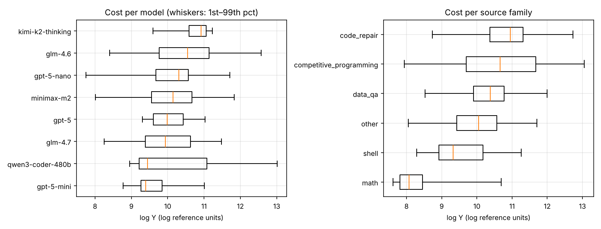

*Distribution of log Y per model and per source family (boxes: quartiles; whiskers: 1st–99th percentile).*

**Within-cell spread** (cells with ≥ 10 runs):

| metric   | stat               |   value |      lo |      hi |
|:---------|:-------------------|--------:|--------:|--------:|
| maxmin   | median             |   4.573 |   4.135 |   4.918 |
| maxmin   | p90                |  21.398 |  19.878 |  23.078 |
| p90p10   | median             |   2.151 |   2.067 |   2.24  |
| p90p10   | p90                |   5.872 |   5.483 |   6.124 |
| sd_logY  | median             |   0.383 |   0.365 |   0.395 |
| sd_logY  | p90                |   0.742 |   0.722 |   0.761 |
| maxmin   | share_cells_ge_30x |   0.047 | nan     | nan     |
| maxmin   | max                | 222.916 | nan     | nan     |

**Tail index** (Hill, top 5% of Y per model; α < 2 means infinite variance):

| model_id   |     n |   hill_alpha |    lo |    hi |
|:-----------|------:|-------------:|------:|------:|
| glm-4.6    | 41111 |        2.251 | 2.167 | 2.343 |
| gpt-5-nano | 27268 |        2.586 | 2.39  | 2.792 |
| glm-4.7    | 24742 |        6.511 | 6.09  | 7.058 |
| minimax-m2 |  5000 |        3.755 | 3.417 | 4.207 |

**Bimodality** (cells with ≥ 20 runs; BIC prefers a 2-component mixture on log Y):

|   n_cells |   share_bic_prefers_2 |    lo |    hi |
|----------:|----------------------:|------:|------:|
|      1099 |                 0.403 | 0.376 | 0.431 |

**Scaling of log Y with log K** (slope; context growth predicts 1–2):

| model_id         |     n |   slope |    lo |    hi |    r2 |
|:-----------------|------:|--------:|------:|------:|------:|
| glm-4.6          | 41111 |   1.042 | 1.034 | 1.051 | 0.836 |
| gpt-5-nano       | 27268 |   1.344 | 1.328 | 1.36  | 0.798 |
| glm-4.7          | 24742 |   0.943 | 0.931 | 0.954 | 0.832 |
| minimax-m2       |  5000 |   0.95  | 0.933 | 0.968 | 0.73  |
| qwen3-coder-480b |   135 |   1.423 | 1.354 | 1.503 | 0.954 |
| gpt-5-mini       |    94 |   0.991 | 0.843 | 1.146 | 0.7   |
| gpt-5            |    76 |   0.972 | 0.692 | 1.353 | 0.307 |
| kimi-k2-thinking |    64 |   0.662 | 0.364 | 0.898 | 0.49  |

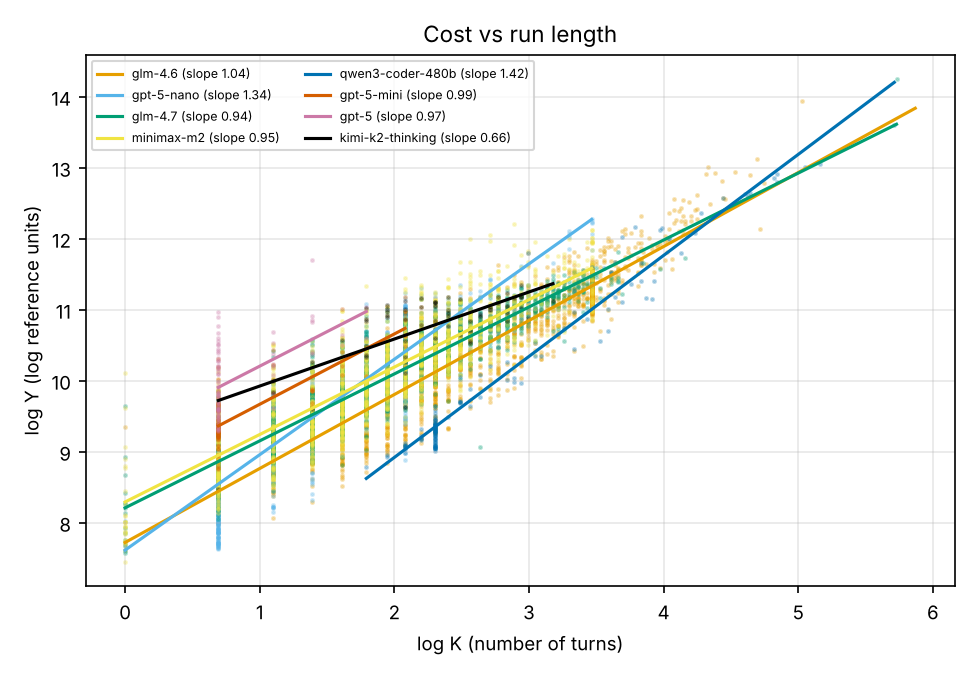

*log Y against log K with per-model least-squares fits.*

**Cost vs outcome.** The spec success label is available for few runs and is almost always a failure (errored runs); the exploratory `completed` proxy is shown per source:

| label     | source                      |     n |   share_label1 |   median_logY_1 |   median_logY_0 |   cost_share_on_0 |
|:----------|:----------------------------|------:|---------------:|----------------:|----------------:|------------------:|
| success   | swesmith                    |   812 |          0.002 |          10.037 |          11.095 |             0.999 |
| completed | Inferred Bugs               |  5000 |          0.226 |          10.02  |          10.16  |             0.801 |
| completed | Nemotron Prism              |    44 |          0.955 |           9.452 |           8.655 |             0.033 |
| completed | Qasper                      |  5416 |          0.645 |          10.029 |          10.24  |             0.403 |
| completed | StackExchange Overflow      |  5000 |          0.797 |          10.13  |          10.302 |             0.254 |
| completed | WikiTable Format Conversion |    72 |          0.417 |           9.217 |           9.25  |             0.592 |
| completed | bash textbook               |  1542 |          0.636 |           9.147 |          10.436 |             0.609 |
| completed | code_contests               |    63 |          0.667 |          10.68  |          12.16  |             0.685 |
| completed | defects 4j                  |  5582 |          0.032 |          10.973 |          10.67  |             0.963 |
| completed | exp_tas                     | 15873 |          0.739 |           9.651 |          10.295 |             0.395 |
| completed | freelancer                  |  4999 |          0.254 |           9.768 |          10.485 |             0.831 |
| completed | math                        |    88 |          0.943 |           8.132 |          10.018 |             0.248 |
| completed | neulab                      |  4999 |          0.281 |           8.943 |          10.374 |             0.885 |
| completed | nl2bash                     |  5000 |          0.979 |           9.001 |           9.333 |             0.029 |
| completed | puzzles                     |  1939 |          0.947 |           8.012 |           9.478 |             0.18  |
| completed | r2egym                      |  5000 |          0.475 |          11.51  |          11.232 |             0.497 |
| completed | stack_exchange              | 22458 |          0.599 |          10.274 |          10.597 |             0.446 |
| completed | swesmith                    |  4894 |          0.622 |          11.231 |          11.178 |             0.337 |
| completed | taskmaster                  |  5000 |          0.566 |           9.571 |          10.671 |             0.651 |
| completed | unknown                     |  5492 |          0.636 |           9.934 |          10.799 |             0.546 |

## 5. Variance decomposition (E2)

| Component             | Level share of Var(log Y)   | Spread share of Var(log SD), noise-corrected   |
|:----------------------|:----------------------------|:-----------------------------------------------|
| Model (fixed effects) | 0.154 (0.141, 0.168)        | 0.392 (0.359, 0.426)                           |
| Task                  | 0.202 (0.183, 0.22)         | 0.0292 (0.000914, 0.0498)                      |
| Task × model          | 0.159 (0.146, 0.171)        | —                                              |
| Run noise / residual  | 0.485 (0.472, 0.499)        | 0.579 (0.552, 0.609)                           |

Crossed design: tasks with ≥ 2 models each having ≥ 4 runs (models with < 20 such cells dropped): 1,440 tasks, 3,403 cells, 49,811 runs (glm-4.6 22,206, glm-4.7 16,736, gpt-5-nano 10,869). Level shares from a REML mixed model (model fixed; task and task × model random); spread shares from a mixed model for the log within-cell SD with its sampling-noise variance subtracted. CIs: 200 task-cluster bootstrap refits.

**Spread transfer** (disattenuated Spearman correlation of a task's log within-cell SD between models):

| model_a   | model_b    |   shared_tasks |   r_obs |   rel_a |   rel_b |   r_disattenuated |     lo |     hi |
|:----------|:-----------|---------------:|--------:|--------:|--------:|------------------:|-------:|-------:|
| glm-4.6   | glm-4.7    |            523 |   0.087 |   0.38  |   0.696 |             0.17  |  0.003 |  0.329 |
| glm-4.6   | gpt-5-nano |           1440 |   0.051 |   0.38  |   0.505 |             0.117 | -0.002 |  0.233 |
| glm-4.7   | gpt-5-nano |            523 |  -0.088 |   0.696 |   0.505 |            -0.148 | -0.294 | -0.01  |

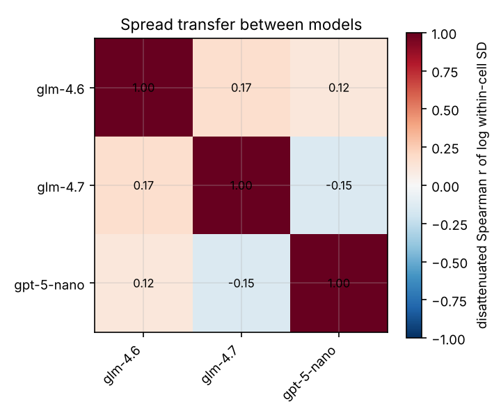

*Heatmap of the disattenuated correlations.* Predicting a cell's log SD from pre-run features on held-out tasks gives R² = 0.344 (0.321, 0.364) (Spearman 0.606); most of that signal is the model identity (see the spread decomposition).

## 6. Cold pre-run results (E3)

**Metrics.** *QCRPS* approximates the continuous ranked probability score from the 99 quantiles: (2/99) Σ_j ρ_τj(y − q_j), the average pinball loss over all levels; it rewards calibration and sharpness together, is in log-cost units, and lower is better (for a point forecast it reduces to absolute error). *PIT* is the forecast CDF evaluated at the outcome; it is uniform when the forecast is calibrated, and PIT KS is its Kolmogorov–Smirnov distance from uniform. *Coverage* is the share of outcomes inside a central interval. Primary aggregate: mean QCRPS within task, then across tasks. CIs: task-cluster bootstrap (B = 1,000).

| Method               | QCRPS task-wt (CI)       | QCRPS run-wt   | Gain vs P1              | Pinball .5 / .9 / .99   | Spearman   | MAE (log)   | Cov 80 / 90 / 95      |   Width 10–90 | PIT KS      | DQ p (τ=.9)   |
|:---------------------|:-------------------------|:---------------|:------------------------|:------------------------|:-----------|:------------|:----------------------|--------------:|:------------|:--------------|
| P0 global            | 0.612 (0.606, 0.617)     | 0.492          | -66.1% (-67.7%, -64.3%) | 0.446 / 0.159 / 0.024   | 0.21       | 0.891       | 0.708 / 0.846 / 0.923 |          2.27 | **0.00169** | <0.001        |
| P1 source × model    | 0.369 (0.365, 0.372)     | 0.370          | 0.0% (0.0%, 0.0%)       | 0.257 / 0.109 / 0.016   | 0.576      | 0.513       | 0.796 / 0.898 / 0.95  |          1.61 | 0.00199     | <0.001        |
| P2 hetero log-normal | 0.320 (0.316, 0.323)     | 0.336          | 13.3% (12.8%, 13.8%)    | 0.221 / 0.100 / 0.019   | **0.676**  | 0.442       | 0.802 / 0.891 / 0.934 |          1.35 | 0.0164      | <0.001        |
| P3 quantile GBM      | 0.315 (0.312, 0.318)     | 0.334          | 14.5% (14.0%, 15.0%)    | 0.217 / 0.099 / 0.017   | 0.675      | 0.433       | 0.77 / 0.872 / 0.927  |          1.32 | 0.033       | <0.001        |
| P3-EVT               | 0.315 (0.312, 0.318)     | 0.334          | 14.5% (14.0%, 15.0%)    | 0.217 / 0.099 / 0.017   | 0.675      | 0.433       | 0.79 / 0.888 / 0.941  |          1.39 | 0.033       | <0.001        |
| P4 MDN (K = 3)       | 0.321 (0.317, 0.324)     | 0.338          | 13.0% (12.4%, 13.6%)    | 0.221 / 0.099 / 0.015   | 0.668      | 0.442       | 0.788 / 0.892 / 0.947 |          1.34 | 0.0226      | <0.001        |
| P5 structural        | 0.314 (0.311, 0.317)     | **0.332**      | 14.8% (14.3%, 15.4%)    | 0.216 / 0.097 / 0.016   | 0.673      | **0.432**   | 0.825 / 0.912 / 0.956 |          1.4  | 0.0102      | <0.001        |
| P6 linear            | 0.336 (0.333, 0.339)     | 0.349          | 8.9% (8.3%, 9.4%)       | 0.232 / 0.102 / 0.019   | 0.662      | 0.464       | 0.798 / 0.887 / 0.932 |          1.43 | 0.0149      | <0.001        |
| P4 MDN (K = 1)       | 0.332 (0.329, 0.335)     | 0.343          | 10.0% (9.5%, 10.6%)     | 0.227 / 0.101 / 0.017   | 0.673      | 0.454       | 0.836 / 0.916 / 0.955 |          1.56 | 0.0308      | <0.001        |
| P4 MDN (K = 2)       | 0.324 (0.320, 0.327)     | 0.337          | 12.2% (11.6%, 12.8%)    | 0.223 / 0.100 / 0.016   | 0.672      | 0.446       | 0.794 / 0.897 / 0.953 |          1.38 | 0.0168      | <0.001        |
| CQR(P3-EVT)          | 0.315 (0.312, 0.318)     | 0.333          | 14.5% (14.0%, 15.0%)    | 0.217 / 0.099 / 0.017   | 0.675      | 0.433       | 0.805 / 0.9 / 0.952   |          1.42 | 0.022       | <0.001        |
| CQR(P5)              | **0.314 (0.311, 0.317)** | 0.333          | 14.9% (14.3%, 15.4%)    | 0.216 / 0.098 / 0.016   | 0.673      | 0.432       | 0.8 / 0.899 / 0.951   |          1.33 | 0.0255      | <0.001        |

The DQ test rejects for every method (p < 0.001): with ~98k runs, exceedances of the 90% quantile are predictable from model, source family and instruction length for all forecasters, i.e. each is miscalibrated in some identifiable sub-population even when overall coverage is close to nominal (per-group PIT/coverage in `e3_pit_by_group.csv`).

Best value per column in bold (coverage: closest to nominal is not bolded; width: sharper is only better when calibrated). The best method was chosen on validation data before looking at test results: P5. Stochastic methods use the first pre-specified seed; across 3 seeds: P4 0.321 ± 0.000; P4-K1 0.331 ± 0.001; P4-K2 0.323 ± 0.000; P5 0.314 ± 0.000.

**Paired comparisons** (task-weighted QCRPS difference a − b, Holm-corrected):

| a           | b         |   diff |     lo |     hi |     p |   p_holm | best_method   |
|:------------|:----------|-------:|-------:|-------:|------:|---------:|:--------------|
| P0          | P1        |  0.243 |  0.238 |  0.249 | 0.001 |    0.022 | CQR(best)     |
| P0          | CQR(best) |  0.298 |  0.293 |  0.304 | 0.001 |    0.022 | CQR(best)     |
| P1          | CQR(best) |  0.055 |  0.053 |  0.057 | 0.001 |    0.022 | CQR(best)     |
| P2          | P1        | -0.049 | -0.051 | -0.047 | 0.001 |    0.022 | CQR(best)     |
| P2          | CQR(best) |  0.006 |  0.005 |  0.006 | 0.001 |    0.022 | CQR(best)     |
| P3          | P1        | -0.053 | -0.056 | -0.051 | 0.001 |    0.022 | CQR(best)     |
| P3          | CQR(best) |  0.001 |  0.001 |  0.002 | 0.001 |    0.022 | CQR(best)     |
| P3-EVT      | P1        | -0.053 | -0.055 | -0.051 | 0.001 |    0.022 | CQR(best)     |
| P3-EVT      | CQR(best) |  0.001 |  0.001 |  0.002 | 0.001 |    0.022 | CQR(best)     |
| P4          | P1        | -0.048 | -0.05  | -0.046 | 0.001 |    0.022 | CQR(best)     |
| P4          | CQR(best) |  0.007 |  0.006 |  0.008 | 0.001 |    0.022 | CQR(best)     |
| P5          | P1        | -0.055 | -0.057 | -0.052 | 0.001 |    0.022 | CQR(best)     |
| P5          | CQR(best) |  0     |  0     |  0     | 0.001 |    0.022 | CQR(best)     |
| P6          | P1        | -0.033 | -0.035 | -0.031 | 0.001 |    0.022 | CQR(best)     |
| P6          | CQR(best) |  0.022 |  0.021 |  0.023 | 0.001 |    0.022 | CQR(best)     |
| P4-K1       | P1        | -0.037 | -0.039 | -0.035 | 0.001 |    0.022 | CQR(best)     |
| P4-K1       | CQR(best) |  0.018 |  0.017 |  0.019 | 0.001 |    0.022 | CQR(best)     |
| P4-K2       | P1        | -0.045 | -0.047 | -0.043 | 0.001 |    0.022 | CQR(best)     |
| P4-K2       | CQR(best) |  0.01  |  0.009 |  0.011 | 0.001 |    0.022 | CQR(best)     |
| CQR(P3-EVT) | P1        | -0.053 | -0.056 | -0.051 | 0.001 |    0.022 | CQR(best)     |
| CQR(P3-EVT) | CQR(best) |  0.001 |  0.001 |  0.002 | 0.001 |    0.022 | CQR(best)     |
| CQR(best)   | P1        | -0.055 | -0.057 | -0.053 | 0.001 |    0.022 | CQR(best)     |

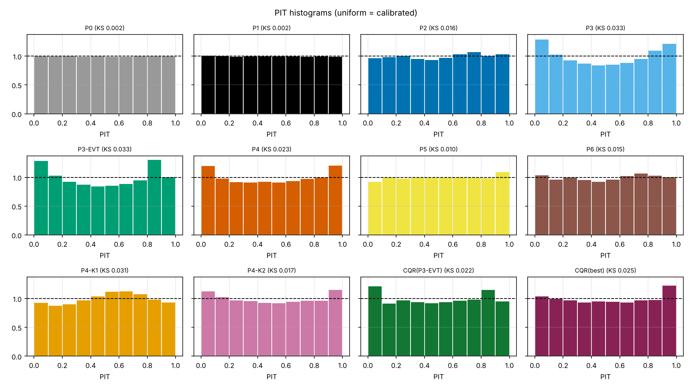

*PIT histograms per method; a flat histogram means calibrated.*

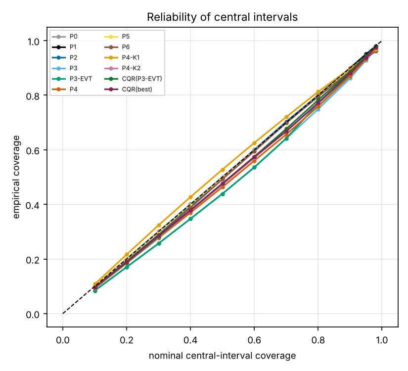

*Nominal vs empirical coverage of central intervals.*

**Conformal intervals** (CQR, calibrated on one run per task of held-out training tasks):

| method      | variant   | interval    |   nominal |   coverage |    lo |    hi |   mean_width |
|:------------|:----------|:------------|----------:|-----------:|------:|------:|-------------:|
| CQR(P3-EVT) | pooled    | central 50% |      0.5  |      0.476 | 0.47  | 0.482 |        0.699 |
| CQR(P3-EVT) | pooled    | central 80% |      0.8  |      0.781 | 0.775 | 0.786 |        1.415 |
| CQR(P3-EVT) | pooled    | central 90% |      0.9  |      0.886 | 0.881 | 0.89  |        1.897 |
| CQR(P3-EVT) | pooled    | central 95% |      0.95 |      0.947 | 0.944 | 0.95  |        2.449 |
| CQR(P3-EVT) | pooled    | upper 90%   |      0.9  |      0.888 | 0.883 | 0.893 |      nan     |
| CQR(P3-EVT) | pooled    | upper 95%   |      0.95 |      0.94  | 0.936 | 0.943 |      nan     |
| CQR(P3-EVT) | pooled    | upper 99%   |      0.99 |      0.988 | 0.987 | 0.989 |      nan     |
| CQR(P3-EVT) | mondrian  | central 50% |      0.5  |      0.479 | 0.473 | 0.485 |        0.706 |
| CQR(P3-EVT) | mondrian  | central 80% |      0.8  |      0.783 | 0.777 | 0.788 |        1.418 |
| CQR(P3-EVT) | mondrian  | central 90% |      0.9  |      0.885 | 0.881 | 0.889 |        1.894 |
| CQR(P3-EVT) | mondrian  | central 95% |      0.95 |      0.945 | 0.942 | 0.948 |        2.425 |
| CQR(P3-EVT) | mondrian  | upper 90%   |      0.9  |      0.887 | 0.882 | 0.891 |      nan     |
| CQR(P3-EVT) | mondrian  | upper 95%   |      0.95 |      0.939 | 0.935 | 0.942 |      nan     |
| CQR(P3-EVT) | mondrian  | upper 99%   |      0.99 |      0.988 | 0.987 | 0.989 |      nan     |
| CQR(best)   | pooled    | central 50% |      0.5  |      0.476 | 0.47  | 0.482 |        0.688 |
| CQR(best)   | pooled    | central 80% |      0.8  |      0.772 | 0.766 | 0.777 |        1.328 |
| CQR(best)   | pooled    | central 90% |      0.9  |      0.88  | 0.875 | 0.885 |        1.8   |
| CQR(best)   | pooled    | central 95% |      0.95 |      0.938 | 0.935 | 0.941 |        2.277 |
| CQR(best)   | pooled    | upper 90%   |      0.9  |      0.891 | 0.886 | 0.896 |      nan     |
| CQR(best)   | pooled    | upper 95%   |      0.95 |      0.94  | 0.936 | 0.944 |      nan     |
| CQR(best)   | pooled    | upper 99%   |      0.99 |      0.988 | 0.987 | 0.989 |      nan     |
| CQR(best)   | mondrian  | central 50% |      0.5  |      0.476 | 0.47  | 0.481 |        0.689 |
| CQR(best)   | mondrian  | central 80% |      0.8  |      0.773 | 0.767 | 0.778 |        1.334 |
| CQR(best)   | mondrian  | central 90% |      0.9  |      0.875 | 0.87  | 0.879 |        1.782 |
| CQR(best)   | mondrian  | central 95% |      0.95 |      0.933 | 0.929 | 0.936 |        2.241 |
| CQR(best)   | mondrian  | upper 90%   |      0.9  |      0.89  | 0.885 | 0.895 |      nan     |
| CQR(best)   | mondrian  | upper 95%   |      0.95 |      0.94  | 0.936 | 0.943 |      nan     |
| CQR(best)   | mondrian  | upper 99%   |      0.99 |      0.987 | 0.985 | 0.988 |      nan     |

**Sensitivity and ablation** (primary metric only):

| analysis                                              | method   |   n_runs |   qcrps |    lo |    hi |   diff_vs_P1 |   diff_lo |   diff_hi |   rel_gain |   degradation_loso_minus_cv |
|:------------------------------------------------------|:---------|---------:|--------:|------:|------:|-------------:|----------:|----------:|-----------:|----------------------------:|
| primary target (reference)                            | P1       |    98501 |   0.369 | 0.365 | 0.372 |      nan     |   nan     |   nan     |    nan     |                     nan     |
| primary target (reference)                            | P5       |    98501 |   0.314 | 0.311 | 0.317 |       -0.055 |    -0.057 |    -0.052 |      0.148 |                     nan     |
| summarization-flagged runs excluded                   | P1       |    97054 |   0.367 | 0.364 | 0.371 |      nan     |   nan     |   nan     |    nan     |                     nan     |
| summarization-flagged runs excluded                   | P5       |    97054 |   0.313 | 0.31  | 0.316 |       -0.054 |    -0.056 |    -0.052 |      0.147 |                     nan     |
| hidden-reasoning models excluded (visible = billed)   | P1       |    71063 |   0.347 | 0.343 | 0.351 |      nan     |   nan     |   nan     |    nan     |                     nan     |
| hidden-reasoning models excluded (visible = billed)   | P5       |    71063 |   0.315 | 0.312 | 0.319 |       -0.032 |    -0.034 |    -0.03  |      0.091 |                     nan     |
| target y_tok                                          | P1       |    98501 |   0.533 | 0.528 | 0.537 |      nan     |   nan     |   nan     |    nan     |                     nan     |
| target y_tok                                          | P5       |    98501 |   0.458 | 0.454 | 0.463 |       -0.074 |    -0.077 |    -0.072 |      0.14  |                     nan     |
| target y_hi                                           | P1       |    98501 |   0.361 | 0.357 | 0.364 |      nan     |   nan     |   nan     |    nan     |                     nan     |
| target y_hi                                           | P5       |    98501 |   0.308 | 0.305 | 0.311 |       -0.053 |    -0.055 |    -0.051 |      0.146 |                     nan     |
| leave-family-out: code_repair                         | P1       |    20476 |   0.664 | 0.656 | 0.672 |      nan     |   nan     |   nan     |    nan     |                     nan     |
| grouped-task CV on same runs: code_repair             | P1       |    20476 |   0.313 | 0.307 | 0.319 |      nan     |   nan     |   nan     |    nan     |                       0.351 |
| leave-family-out: code_repair                         | P5       |    20476 |   0.59  | 0.581 | 0.598 |      nan     |   nan     |   nan     |    nan     |                     nan     |
| grouped-task CV on same runs: code_repair             | P5       |    20476 |   0.286 | 0.28  | 0.291 |      nan     |   nan     |   nan     |    nan     |                       0.304 |
| leave-family-out: competitive_programming             | P1       |       81 |   1.75  | 1.456 | 2.065 |      nan     |   nan     |   nan     |    nan     |                     nan     |
| grouped-task CV on same runs: competitive_programming | P1       |       81 |   0.691 | 0.583 | 0.808 |      nan     |   nan     |   nan     |    nan     |                       1.059 |
| leave-family-out: competitive_programming             | P5       |       81 |   1     | 0.796 | 1.23  |      nan     |   nan     |   nan     |    nan     |                     nan     |
| grouped-task CV on same runs: competitive_programming | P5       |       81 |   0.683 | 0.568 | 0.808 |      nan     |   nan     |   nan     |    nan     |                       0.316 |
| leave-family-out: data_qa                             | P1       |    32946 |   0.468 | 0.462 | 0.474 |      nan     |   nan     |   nan     |    nan     |                     nan     |
| grouped-task CV on same runs: data_qa                 | P1       |    32946 |   0.439 | 0.432 | 0.446 |      nan     |   nan     |   nan     |    nan     |                       0.029 |
| leave-family-out: data_qa                             | P5       |    32946 |   0.636 | 0.623 | 0.647 |      nan     |   nan     |   nan     |    nan     |                     nan     |
| grouped-task CV on same runs: data_qa                 | P5       |    32946 |   0.421 | 0.414 | 0.428 |      nan     |   nan     |   nan     |    nan     |                       0.215 |
| leave-family-out: math                                | P1       |     2071 |   1.573 | 1.542 | 1.603 |      nan     |   nan     |   nan     |    nan     |                     nan     |
| grouped-task CV on same runs: math                    | P1       |     2071 |   0.35  | 0.33  | 0.371 |      nan     |   nan     |   nan     |    nan     |                       1.223 |
| leave-family-out: math                                | P5       |     2071 |   1.429 | 1.401 | 1.457 |      nan     |   nan     |   nan     |    nan     |                     nan     |
| grouped-task CV on same runs: math                    | P5       |     2071 |   0.254 | 0.239 | 0.269 |      nan     |   nan     |   nan     |    nan     |                       1.175 |
| leave-family-out: other                               | P1       |    31363 |   0.503 | 0.493 | 0.513 |      nan     |   nan     |   nan     |    nan     |                     nan     |
| grouped-task CV on same runs: other                   | P1       |    31363 |   0.476 | 0.466 | 0.485 |      nan     |   nan     |   nan     |    nan     |                       0.027 |
| leave-family-out: other                               | P5       |    31363 |   0.518 | 0.509 | 0.529 |      nan     |   nan     |   nan     |    nan     |                     nan     |
| grouped-task CV on same runs: other                   | P5       |    31363 |   0.316 | 0.309 | 0.322 |      nan     |   nan     |   nan     |    nan     |                       0.202 |
| leave-family-out: shell                               | P1       |    11564 |   0.817 | 0.804 | 0.828 |      nan     |   nan     |   nan     |    nan     |                     nan     |
| grouped-task CV on same runs: shell                   | P1       |    11564 |   0.343 | 0.337 | 0.348 |      nan     |   nan     |   nan     |    nan     |                       0.474 |
| leave-family-out: shell                               | P5       |    11564 |   0.651 | 0.643 | 0.658 |      nan     |   nan     |   nan     |    nan     |                     nan     |
| grouped-task CV on same runs: shell                   | P5       |    11564 |   0.298 | 0.293 | 0.302 |      nan     |   nan     |   nan     |    nan     |                       0.353 |
| ablation (a) model + source only                      | P5       |    98501 |   0.369 | 0.366 | 0.373 |      nan     |   nan     |   nan     |    nan     |                     nan     |
| ablation (b) + numeric text stats                     | P5       |    98501 |   0.328 | 0.325 | 0.332 |      nan     |   nan     |   nan     |    nan     |                     nan     |
| ablation (c) + keywords                               | P5       |    98501 |   0.328 | 0.324 | 0.331 |      nan     |   nan     |   nan     |    nan     |                     nan     |
| ablation (d) + TF-IDF/SVD (full)                      | P5       |    98501 |   0.314 | 0.311 | 0.317 |      nan     |   nan     |   nan     |    nan     |                     nan     |

**H3 detail** (PIT KS difference vs P2, paired task-cluster bootstrap):

| method   |    ks |   ks_P2 |   diff |     lo |     hi |
|:---------|------:|--------:|-------:|-------:|-------:|
| P3-EVT   | 0.033 |   0.016 |  0.017 |  0.012 |  0.028 |
| P4       | 0.023 |   0.016 |  0.006 |  0.001 |  0.015 |
| P5       | 0.01  |   0.016 | -0.006 | -0.009 | -0.001 |

Per-model and per-family PIT/coverage: `results/tables/e3_pit_by_group.csv`; per-model QCRPS: `results/tables/e3_by_model.csv`; P4 mixture weights: `results/tables/e3_p4_mixture.csv`.

## 7. Warm pre-run results (E4)

S2 test units: target-half runs of cells with ≥ 6 runs (26,625 runs, 1,606 tasks, 2,890 cells); history features come from the disjoint history half. `_H` = with history features, `_noH` = same predictor and rows without them; P1 is the E3 baseline on these runs; the cell oracle (leave-one-out empirical quantiles) is defined on 25,658 runs in cells with ≥ 10 runs. Note that the oracle's empirical quantiles from 10–31 runs are too narrow (its 90% coverage is well below nominal), so it is not a strict lower bound on CRPS; methods within its CI have closed the gap, not leaked.

| population                            | method     |   n_runs |   qcrps |    lo |    hi |   cov90 |   gain_vs_P1 |   gain_lo |   gain_hi | diff_vs_P1   | p_vs_P1   | gap_closed   | gap_lo   | gap_hi   | p_holm   |
|:--------------------------------------|:-----------|---------:|--------:|------:|------:|--------:|-------------:|----------:|----------:|:-------------|:----------|:-------------|:---------|:---------|:---------|
| all S2 test runs                      | P1         |    26625 |   0.337 | 0.329 | 0.346 |   0.908 |       0      |    0      |    0      | —            | —         | —            | —        | —        | —        |
| all S2 test runs                      | P2_noH     |    26625 |   0.308 | 0.3   | 0.316 |   0.881 |       0.0861 |    0.0718 |    0.101  | -0.029       | 0.001     | —            | —        | —        | 0.013    |
| all S2 test runs                      | P2_H       |    26625 |   0.257 | 0.25  | 0.264 |   0.876 |       0.24   |    0.222  |    0.257  | -0.081       | 0.001     | —            | —        | —        | 0.013    |
| all S2 test runs                      | P3-EVT_noH |    26625 |   0.304 | 0.296 | 0.313 |   0.876 |       0.0991 |    0.0859 |    0.113  | -0.033       | 0.001     | —            | —        | —        | 0.013    |
| all S2 test runs                      | P3-EVT_H   |    26625 |   0.253 | 0.246 | 0.26  |   0.879 |       0.251  |    0.234  |    0.268  | -0.085       | 0.001     | —            | —        | —        | 0.013    |
| all S2 test runs                      | P4_noH     |    26625 |   0.303 | 0.294 | 0.312 |   0.875 |       0.102  |    0.0844 |    0.12   | -0.034       | 0.001     | —            | —        | —        | 0.013    |
| all S2 test runs                      | P4_H       |    26625 |   0.257 | 0.25  | 0.264 |   0.886 |       0.238  |    0.221  |    0.257  | -0.080       | 0.001     | —            | —        | —        | 0.013    |
| cells with ≥ 10 runs (oracle defined) | P1         |    25658 |   0.323 | 0.315 | 0.331 |   0.909 |       0      |    0      |    0      | —            | —         | 0            | 0        | 0        | —        |
| cells with ≥ 10 runs (oracle defined) | P2_noH     |    25658 |   0.304 | 0.296 | 0.313 |   0.874 |       0.0573 |    0.0445 |    0.0697 | -0.019       | 0.001     | 0.282        | 0.224    | 0.339    | 0.013    |
| cells with ≥ 10 runs (oracle defined) | P2_H       |    25658 |   0.26  | 0.253 | 0.266 |   0.874 |       0.196  |    0.182  |    0.209  | -0.063       | 0.001     | 0.962        | 0.939    | 0.987    | 0.013    |
| cells with ≥ 10 runs (oracle defined) | P3-EVT_noH |    25658 |   0.299 | 0.29  | 0.309 |   0.878 |       0.0729 |    0.0615 |    0.0847 | -0.024       | 0.001     | 0.358        | 0.303    | 0.413    | 0.013    |
| cells with ≥ 10 runs (oracle defined) | P3-EVT_H   |    25658 |   0.256 | 0.248 | 0.262 |   0.884 |       0.208  |    0.194  |    0.221  | -0.067       | 0.001     | 1.02         | 0.998    | 1.05     | 0.013    |
| cells with ≥ 10 runs (oracle defined) | P4_noH     |    25658 |   0.3   | 0.291 | 0.309 |   0.878 |       0.0705 |    0.0564 |    0.0848 | -0.023       | 0.001     | 0.346        | 0.281    | 0.413    | 0.013    |
| cells with ≥ 10 runs (oracle defined) | P4_H       |    25658 |   0.259 | 0.252 | 0.266 |   0.892 |       0.198  |    0.184  |    0.211  | -0.064       | 0.001     | 0.973        | 0.946    | 1        | 0.013    |
| cells with ≥ 10 runs (oracle defined) | oracle     |    25658 |   0.257 | 0.25  | 0.264 |   0.798 |       0.204  |    0.188  |    0.219  | -0.066       | 0.001     | 1            | 1        | 1        | 0.013    |

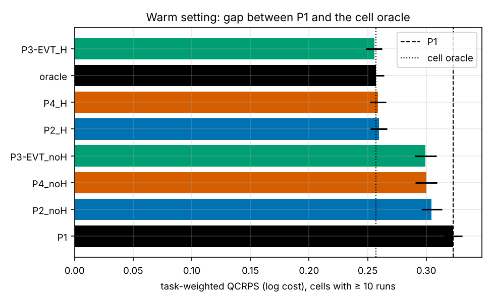

*Task-weighted QCRPS on cells with ≥ 10 runs, between P1 (dashed) and the cell oracle (dotted).*

History vs no history, same predictor and rows:

| method   |   diff_H_minus_noH |      lo |      hi |     p |   p_holm |
|:---------|-------------------:|--------:|--------:|------:|---------:|
| P2       |            -0.0517 | -0.057  | -0.0465 | 0.001 |    0.003 |
| P3-EVT   |            -0.0513 | -0.0568 | -0.0454 | 0.001 |    0.003 |
| P4       |            -0.0461 | -0.0522 | -0.0403 | 0.001 |    0.003 |

## 8. Online results (E5)

**Runs with K > k** — task-weighted QCRPS (n runs: k=0: 98501, k=1: 97975, k=2: 90317, k=4: 77829, k=8: 42137, k=16: 23116, k=32: 4235)

|   k | O1    | O2    | O2-noregime   | P5 (k=0)   |
|----:|:------|:------|:--------------|:-----------|
|   0 | —     | —     | —             | 0.314      |
|   1 | 0.378 | 0.273 | 0.287         | —          |
|   2 | 0.342 | 0.252 | 0.263         | —          |
|   4 | 0.273 | 0.210 | 0.219         | —          |
|   8 | 0.209 | 0.192 | 0.198         | —          |
|  16 | 0.210 | 0.207 | 0.214         | —          |
|  32 | 0.256 | 0.246 | 0.252         | —          |

**Fixed panel of runs with K ≥ 33** — task-weighted QCRPS (n runs: k=0: 4235, k=1: 4235, k=2: 4235, k=4: 4235, k=8: 4235, k=16: 4235, k=32: 4235)

|   k | O1    | O2    | O2-noregime   | P5 (k=0)   |
|----:|:------|:------|:--------------|:-----------|
|   0 | —     | —     | —             | 0.563      |
|   1 | 0.754 | 0.544 | 0.543         | —          |
|   2 | 0.558 | 0.528 | 0.527         | —          |
|   4 | 0.539 | 0.521 | 0.522         | —          |
|   8 | 0.542 | 0.510 | 0.512         | —          |
|  16 | 0.510 | 0.466 | 0.471         | —          |
|  32 | 0.256 | 0.246 | 0.252         | —          |

Coverage of the central 90% interval vs k (eligible runs):

|   k |    O1 |    O2 |   O2-noregime |
|----:|------:|------:|--------------:|
|   1 | 0.641 | 0.871 |         0.866 |
|   2 | 0.669 | 0.863 |         0.862 |
|   4 | 0.676 | 0.849 |         0.851 |
|   8 | 0.789 | 0.85  |         0.849 |
|  16 | 0.862 | 0.847 |         0.847 |
|  32 | 0.862 | 0.829 |         0.841 |

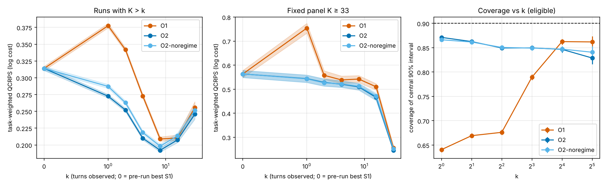

*QCRPS vs number of observed turns k, for both populations (bands: 95% CIs), and 90% coverage vs k.*

## 8b. Trajectory-integrated evaluation (E9)

**ITS** (Integrated Trajectory Score) is the QCRPS of the log total-cost forecast averaged over every decision point of every run (immediately before each model call), weighted by the input tokens of the upcoming call — a proper, distributional version of the area between the forecast and true remaining-cost curves on the token clock; lower is better. **NTA** (Normalized Trajectory Area) is that literal area for the median forecast, divided by the run's total tokens and cost: NTA = 0.3 means the remaining-cost forecast was off by 30% of the run's cost on average over its tokens; it is intuitive but improper (it rewards under-forecasting) and is not used to rank methods.

| Method           | ITS (CI)             |   ITS-rb |   ITS-early |   ITS-turn |   ITS-logR | NTA mean (CI)        |   NTA median |   PIT KS |   Infeasible % |   Time to confidence (median) |
|:-----------------|:---------------------|---------:|------------:|-----------:|-----------:|:---------------------|-------------:|---------:|---------------:|------------------------------:|
| Static           | 0.523 (0.503, 0.546) |    0.314 |       0.296 |      0.386 |      3.698 | 0.588 (0.571, 0.606) |        0.311 |    0.332 |           83.2 |                         0     |
| Static-truncated | 0.297 (0.290, 0.304) |    0.255 |       0.26  |      0.3   |      3.698 | 0.548 (0.53, 0.565)  |        0.269 |    0.332 |            0   |                         0     |
| O1               | 0.210 (0.207, 0.214) |    0.216 |       0.248 |      0.272 |      0.495 | 0.449 (0.433, 0.466) |        0.202 |    0.167 |            0   |                         0.387 |
| O2               | 0.203 (0.199, 0.208) |    0.178 |       0.213 |      0.243 |      0.851 | 0.39 (0.374, 0.406)  |        0.176 |    0.132 |            9.7 |                         0.34  |
| O2-noregime      | 0.211 (0.207, 0.217) |    0.191 |       0.224 |      0.253 |      0.888 | 0.406 (0.39, 0.422)  |        0.188 |    0.147 |           10   |                         0.24  |

ITS-level (natural-scale QCRPS, reference units) and the share of runs that never reach ±25% confidence are in `results/tables/e9_main.csv`; per model and per source family in `e9_by_model.csv`, `e9_by_source_family.csv`; sensitivity in `e9_sensitivity.csv`.

**Comparisons** (paired task-cluster bootstrap, Holm-corrected):

| a                | b                | metric    |   diff |     lo |     hi |     p |   p_holm |
|:-----------------|:-----------------|:----------|-------:|-------:|-------:|------:|---------:|
| O2               | Static-truncated | ITS       | -0.093 | -0.096 | -0.091 | 0.001 |    0.006 |
| O2               | O2-noregime      | ITS       | -0.008 | -0.008 | -0.008 | 0.001 |    0.006 |
| O2               | O2-noregime      | ITS_early | -0.011 | -0.012 | -0.011 | 0.001 |    0.006 |
| O2               | O1               | ITS       | -0.007 | -0.009 | -0.005 | 0.001 |    0.006 |
| O1               | Static-truncated | ITS       | -0.087 | -0.09  | -0.083 | 0.001 |    0.006 |
| Static-truncated | Static           | ITS       | -0.226 | -0.243 | -0.212 | 0.001 |    0.006 |

**Ranking agreement.** The metrics rank methods differently — ITS: O2 < O1 < O2-noregime < Static-truncated < Static; ITS_rb: O2 < O2-noregime < O1 < Static-truncated < Static; ITS_logR: O1 < O2 < O2-noregime < Static-truncated < Static; NTA_mean: O2 < O2-noregime < O1 < Static-truncated < Static. ITS is the authoritative comparison; ITS-logR emphasizes late-run relative accuracy, and NTA is improper (it rewards under-forecasting), so disagreements with them do not change the verdicts.

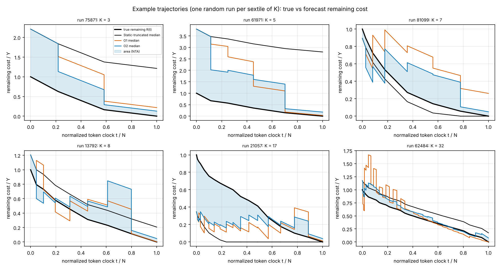

*Six runs drawn at random (seed SEED + 9), one per sextile of K: true remaining cost (black) and forecast medians; the shaded band is O2's NTA area.*

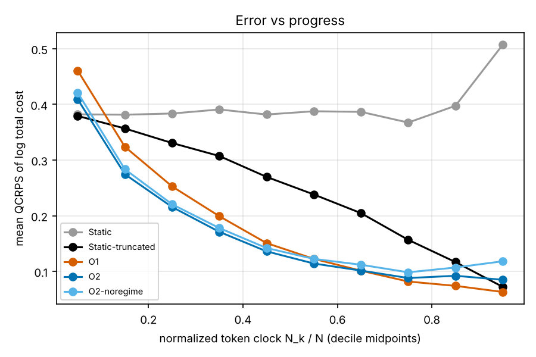

*Mean QCRPS of the total-cost forecast by decile of the normalized token clock.*

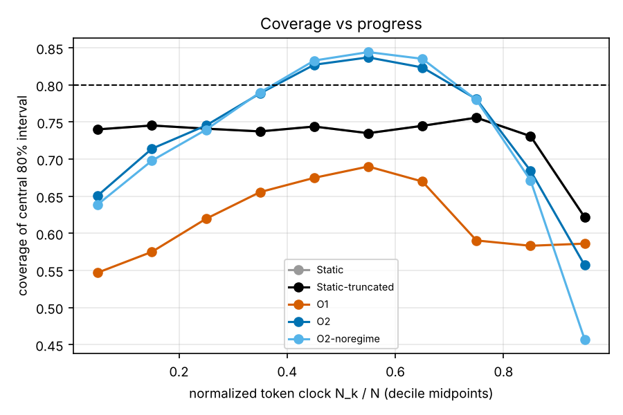

*Coverage of the central 80% interval by progress decile (dashed: nominal).*

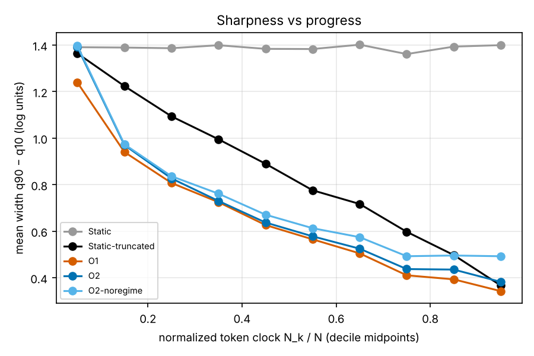

*Mean width of the 10–90% interval by progress decile.*

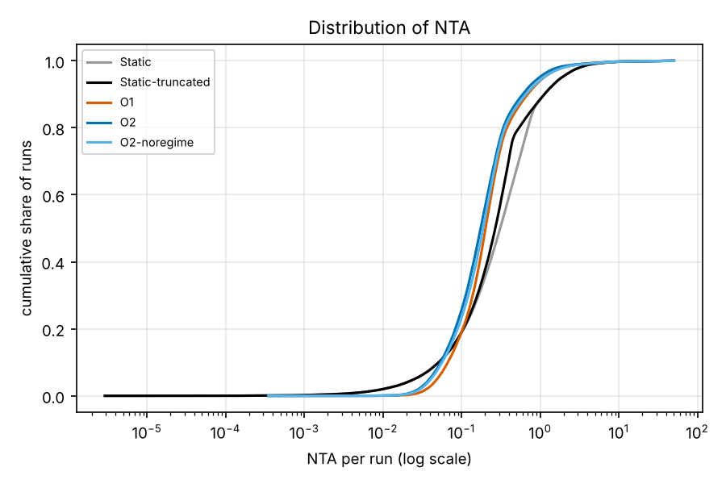

*Cumulative distribution of per-run NTA (log scale).*

**E9 sanity checks** (§A.7; 4a re-scores the base per-k O2 forecasts through the E9 pipeline, 4b is informative: the pooled O2 used in E9 is less accurate than the base per-k models at the grid points):

| check                                                              | value_a   | value_b   | passed   | lo_b   | hi_b   |
|:-------------------------------------------------------------------|:----------|:----------|:---------|:-------|:-------|
| 1 Static ITS = weighted pre-run QCRPS                              | 0.523     | 0.523     | True     | —      | —      |
| 4a O2 per-k at k=1: E5 table vs E9 pipeline on the same forecasts  | 0.273     | 0.273     | True     | 0.270  | 0.275  |
| 4b (info) pooled O2 minus per-k O2 at k=1                          | 0.273     | 0.330     | nan      | 0.056  | 0.060  |
| 4a O2 per-k at k=2: E5 table vs E9 pipeline on the same forecasts  | 0.252     | 0.252     | True     | 0.249  | 0.255  |
| 4b (info) pooled O2 minus per-k O2 at k=2                          | 0.252     | 0.289     | nan      | 0.035  | 0.038  |
| 4a O2 per-k at k=4: E5 table vs E9 pipeline on the same forecasts  | 0.210     | 0.210     | True     | 0.208  | 0.212  |
| 4b (info) pooled O2 minus per-k O2 at k=4                          | 0.210     | 0.232     | nan      | 0.021  | 0.023  |
| 4a O2 per-k at k=8: E5 table vs E9 pipeline on the same forecasts  | 0.192     | 0.192     | True     | 0.189  | 0.195  |
| 4b (info) pooled O2 minus per-k O2 at k=8                          | 0.192     | 0.211     | nan      | 0.018  | 0.020  |
| 4a O2 per-k at k=16: E5 table vs E9 pipeline on the same forecasts | 0.207     | 0.207     | True     | 0.203  | 0.211  |
| 4b (info) pooled O2 minus per-k O2 at k=16                         | 0.207     | 0.218     | nan      | 0.009  | 0.012  |
| 4a O2 per-k at k=32: E5 table vs E9 pipeline on the same forecasts | 0.246     | 0.246     | True     | 0.238  | 0.253  |
| 4b (info) pooled O2 minus per-k O2 at k=32                         | 0.246     | 0.279     | nan      | 0.028  | 0.039  |
| 5 rows = sum of K over test runs                                   | 1,229,166 | 1,229,166 | True     | —      | —      |

**Diagnostics** (infeasible = any quantile below the cost already spent, before correction; O1 source shares; forecasts with k > 64 use k = 64 in O2-pooled):

| method           |   infeasible_pct |   ttc_median |   ttc_never_share |   PIT_KS_w |   cov80_w |   O1_per_k_share |   O1_pooled_share |   n_forecasts_k_gt_64 |
|:-----------------|-----------------:|-------------:|------------------:|-----------:|----------:|-----------------:|------------------:|----------------------:|
| Static           |          83.2448 |       0      |            0.618  |     0.3322 |    0.6163 |          nan     |          nan      |                 17595 |
| Static-truncated |           0      |       0      |            0.3186 |     0.3322 |    0.6163 |          nan     |          nan      |                 17595 |
| O1               |           0      |       0.3873 |            0.1503 |     0.1668 |    0.6422 |            0.273 |            0.6468 |                 17595 |
| O2               |           9.7436 |       0.3399 |            0.1178 |     0.1323 |    0.7094 |          nan     |          nan      |                 17595 |
| O2-noregime      |          10.0244 |       0.24   |            0.2915 |     0.1475 |    0.7014 |          nan     |          nan      |                 17595 |

## 9. Capacity (E6)

E6 was not run: `llm_predictor.enabled` is false (default; the user did not enable it); no API key is configured in the environment. H5 is therefore recorded as *skipped*.

## 10. Distribution shift (E7)

Temporal split (dates cover 100% of runs): training = runs up to the 70th-percentile date (`2025-12-24`, 68,951 runs); test = later runs whose task group never appears in training (7,339 runs; 22,211 later runs removed because their task appears in training). The forecaster is P5 refit on the temporal training set. Test runs by source: unknown 4,868, taskmaster 1,442, swesmith 915, r2egym 114 — the shift is largely to unseen sources.

| method     |   n_test |   coverage |   cov_lo |   cov_hi |   width |   width_lo |   width_hi |   rolling_cov_min |   rolling_cov_max |   share_windows_below_85 |
|:-----------|---------:|-----------:|---------:|---------:|--------:|-----------:|-----------:|------------------:|------------------:|-------------------------:|
| raw P5     |     7339 |      0.711 |    0.694 |    0.727 |   2.03  |      2.022 |      2.037 |             0.468 |             0.956 |                    0.767 |
| static CQR |     7339 |      0.697 |    0.68  |    0.713 |   1.982 |      1.975 |      1.99  |             0.462 |             0.952 |                    0.786 |
| ACI        |     7339 |      0.892 |    0.882 |    0.902 |   2.821 |      2.803 |      2.84  |             0.824 |             0.934 |                    0.02  |

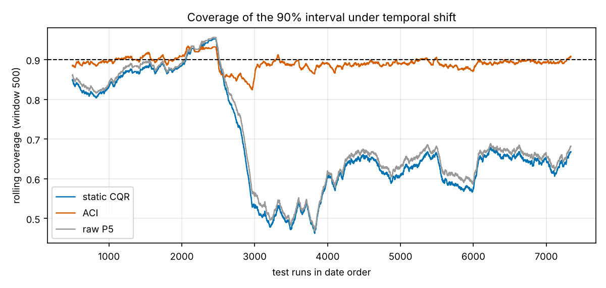

*Rolling coverage (window 500) of the 90% interval in date order: raw quantiles, static CQR and ACI.*

## 11. Decision value (E8)

| Method   |   Cap at τ | Cost saved %         | Runs killed %   | Successes lost % (completed proxy)   |   Cost per success (ref. units) |   … without caps |
|:---------|-----------:|:---------------------|:----------------|:-------------------------------------|--------------------------------:|-----------------:|
| P1       |       0.8  | 13.3% (12.8%, 13.9%) | 14.8%           | 11.7% (11.0%, 12.3%)                 |                          67,691 |           68,981 |
| P1       |       0.9  | 7.4% (7.0%, 7.9%)    | 7.0%            | 5.0% (4.7%, 5.4%)                    |                          67,249 |           68,981 |
| P1       |       0.95 | 4.0% (3.7%, 4.4%)    | 3.4%            | 2.2% (2.0%, 2.4%)                    |                          67,718 |           68,981 |
| P1       |       0.99 | 1.2% (0.9%, 1.4%)    | 0.7%            | 0.4% (0.3%, 0.4%)                    |                          68,423 |           68,981 |
| CQR(P5)  |       0.8  | 13.5% (12.9%, 14.1%) | 15.6%           | 13.7% (13.1%, 14.4%)                 |                          69,178 |           68,981 |
| CQR(P5)  |       0.9  | 8.3% (7.8%, 8.7%)    | 8.3%            | 7.0% (6.6%, 7.5%)                    |                          68,051 |           68,981 |
| CQR(P5)  |       0.95 | 5.0% (4.6%, 5.4%)    | 4.6%            | 3.6% (3.3%, 3.9%)                    |                          68,011 |           68,981 |
| CQR(P5)  |       0.99 | 1.5% (1.3%, 1.8%)    | 1.0%            | 0.7% (0.6%, 0.8%)                    |                          68,416 |           68,981 |

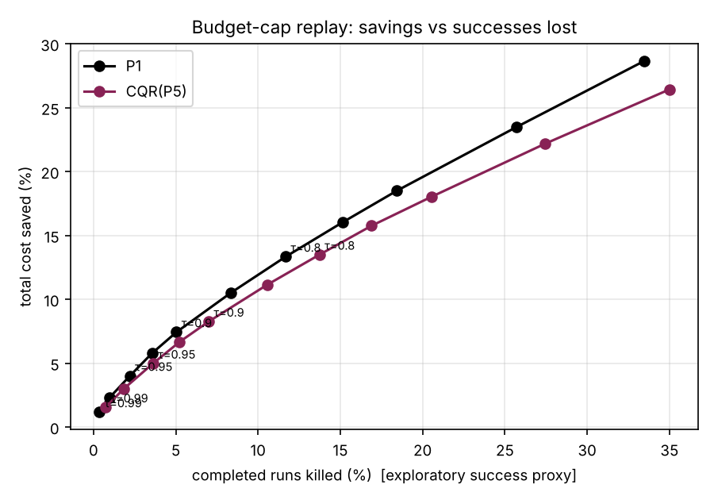

*Cost saved vs completed runs killed as the cap quantile τ varies.*

### Sanity checks (spec §A.6)

1. P1 beats P0: QCRPS difference P0 − P1 = 0.243 (0.238, 0.249) — **pass**.
2. Cell oracle lowest in E4: oracle 0.257 (0.250, 0.264); best other method P3-EVT_H 0.256 — not material (within the oracle's CI). The oracle uses noisy empirical quantiles of 10–31 runs (90% coverage 0.798), so a smoothing model can match it; history features use only the disjoint history half (tested), so this is not leakage.
3. P3 raw 90% coverage 0.872 (within ±10 points: pass); CQR 90% coverage CQR(P3-EVT) 0.886, CQR(best) 0.88 (within ±2 points: pass).
4. PIT histograms of simulated, correctly specified forecasts are flat — unit test `tests/test_metrics.py::test_pit_uniform_when_calibrated` passes.
5. Online CRPS at k = 1 not worse than k = 0: O1 0.378 vs k = 0 on the same runs (difference 0.071 [0.068, 0.074]: FAIL); O2 0.273 vs k = 0 on the same runs (difference -0.034 [-0.035, -0.032]: pass); O2-noregime 0.287 vs k = 0 on the same runs (difference -0.019 [-0.020, -0.018]: pass). O1 fails: it places all uncertainty in the remaining number of turns and extrapolates per-turn costs mechanically, so early in a run its intervals are far too narrow (90% coverage well below nominal at small k); it is reported as is, not tuned after the fact.
6. Every number in this report matches a CSV in `results/tables/` — checked by `python -m src.report.check_report` (log: `results/logs/report_check.md`).
7. No `task_id`, task-name or CV-group overlap between training and test in any fold — `tests/test_splits.py` passes.

## 12. Threats to validity

1. **Visible vs billed cost.** GPT-5-family runs show no reasoning tokens; their cost is a lower bound. Excluding them: P1 0.347 vs P5 0.315 (relative gain 9.1%). Per-model results: `e3_by_model.csv`.
2. **Linear-history assumption.** 1.47% of runs are flagged for summarization. Excluding them: P1 0.367 vs P5 0.313 (relative gain 14.7%).
3. **Canonical tokenizer.** Model tokenizers differ from o200k_base by a near-constant factor (median ratios glm-4.6 1.01, glm-4.7 1.01, minimax-m2 1, qwen3-coder-480b 1.1), absorbed by the model features.
4. **Pricing ratios.** Secondary targets: Y_tok — P1 0.533 vs P5 0.458 (relative gain 14.0%); Y_hi — P1 0.361 vs P5 0.308 (relative gain 14.6%).
5. **Selection.** Cells were sampled by source with a cap of 5,000 runs per source and crossed tasks first; composition vs the full dataset is in §3. Results describe this stratified sample (sources are weighted far more evenly than in AgentTrove, where exp_tas and freelancer dominate).
6. **Training-data provenance.** AgentTrove was assembled as training data. No source has only successful labelled runs, but the success label is sparse and degenerate (it mostly records errors), so outcome filtering cannot be ruled out; several sources' run-length distributions are truncated by turn caps.
7. **Leakage.** All learned transforms (TF-IDF/SVD, category levels, scaling, P2's c, EVT, conformal scores) are fit on training folds; folds are grouped by connected task-name/statement components; history features come from disjoint runs; tests assert no task, name or group overlap (`tests/test_splits.py`).
8. **Multiple comparisons.** Holm correction within each experiment; H1–H6 were pre-registered and are unchanged.

## 13. Reproducibility

- Config hash: `7467eac0c1ad`; global seed 20261101 (component seeds = SEED + sha256(name) mod 10,000).
- Python `3.13.18`; packages: `datasets==5.1.0, joblib==1.6.0, lightgbm==4.7.0, matplotlib==3.11.2, numpy==2.5.3, pandas==3.0.5, pyarrow==26.0.0, pytest==9.2.0, scikit-learn==1.9.1, scipy==1.18.1, statsmodels==0.15.0, tiktoken==0.14.0, tokenizers==0.23.3, torch==2.15.0+cpu`.
- Hardware: 4 CPU cores, 15 GB RAM (spec target 16 cores / 64 GB; sample reduced to 100k runs).
- Step run times (s): `{'tests': 5.9, 'e6': 4.8, 'report': 1.0, 'e1': 32, 'e2': 720, 'e3_fit': 13500, 'e3_eval': 809, 'e4': 821, 'e5': 12729, 'e7': 582, 'e8': 62, 'e3_sens': 5820, '_note': 'e1-e8 times measured from the background-run logs on this 4-core machine'}`.
- Regenerate everything from the cached data: `python -m src.run_all --config config.yaml`.
- Hyperparameters chosen on fold-1 validation: `results/tables/hyperparams.csv`.
- Deviations from the spec (summary): sample size 100k; no `reward` column (exploratory `completed` proxy for E1/E8); task identity by statement hash; ambiguous model strings excluded; summarization sub-calls dropped; O1/O2 reuse P5/P3 hyperparameters; CQR applied to every quantile pair to score it by QCRPS. Full list: `results/DEVIATIONS.md`.
